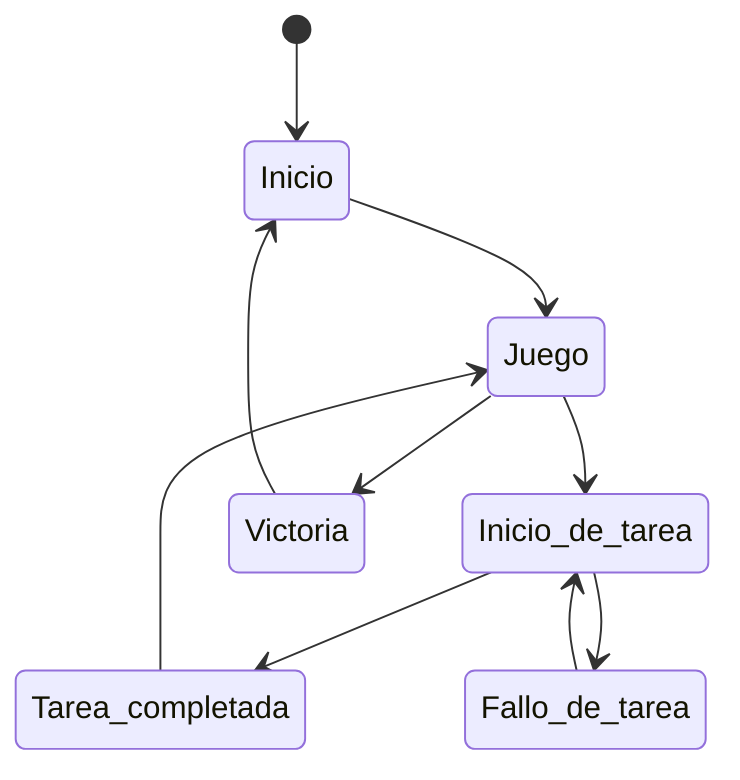
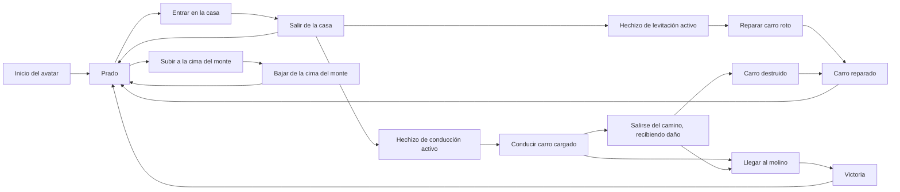
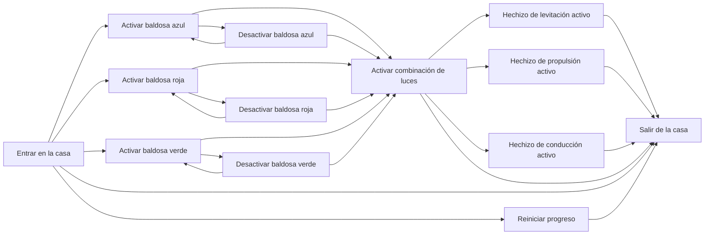
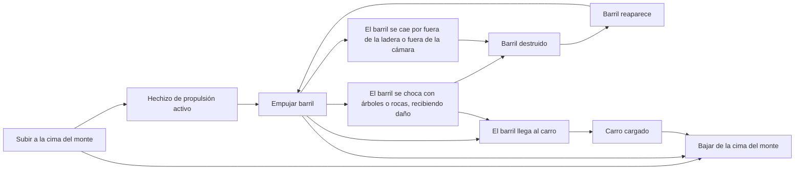
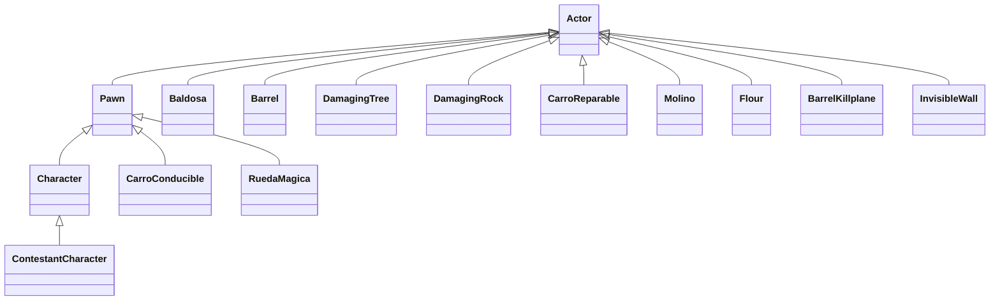

# Fantasy Base
Proyecto para desarrollar videojuegos de magia y fantasía en vista cenital y con control de ratón.

## Descripción
Se trata de un prototipo básico para montar videojuegos 3D en vista cenital y con control de razón de género de puzles para Unreal Engine 5.8.4. Se podría definir el código para controlar a un personaje que realice tareas domésticas, usando la magia, en el escenario.

## Punto de partida
El punto de partida de este proyecto es la plantilla TopDown sin variantes, aunque ahora se ha borrado código algo básico; además se usa contenido de distintos paquetes como StylizedProvincial. 

## Instalación y uso
Los ficheros más importantes del proyecto están disponible en este repositorio, aunque algunos ficheros binarios potencialmente grandes están en el almacén GitHub LFS asociado, y por lo tanto se requiere tener activa la extensión Git LFS cuando lo descarguemos con GitHub Desktop o similar. 

El resto de los ficheros, generalmente de contenido muy pesado o creado por terceros y sin intención de ser modificado en este proyecto, tendrá que descargarse de carpetas compartidas en Google Drive con ficheros ZIP, para después descomprirlos directamente en la carpeta Content. Bastante contenido común a todos los proyectos (StarterContent, LevelPrototyping, ThirdPerson, etc.) está [disponible con acceso general aquí](https://drive.google.com/drive/u/0/folders/1TfoB5S3yQw49-onoFfn0q79PTfk2RoSE) para su descarga.

Para este proyecto en particular hace falta descargar los ficheros ZIP, que ya incluyen las carpetas del mismo nombre, para descomprimirlas directamente en Content: 
* Characters
* Cursor
* LevelPrototyping
* StarterContent
* StylizedProvencal
* TopDown

Para facilitar esta descarga podemos crear un fichero de PowerShell que haga ese trabajo con nosotros: en bucle empezar a descargar uno a uno los ficheros ZIP del contenido, a través del ID público de las carpetas compartidas en Google Drive y si no hay carpetas ya con esos nombres dentro de Content, luego descomprimir y volcar cada uno de ellos en la carpeta Content, destruyéndo el fichero ZIP antes de descargar el siguiente. Hay que recordar que los archivos descomprimidos de cada zip deben estar en una única carpeta con el nombre del fichero zip como subcarpeta de Content.

## Preproducción

El diseño tiene estas secciones:
- [Estética](#Estética)
  * [Gráficos](#Gráficos)
  * [Sonidos](#Sonidos)
- [Dinámica](#Dinámica)
  * [Objetivo](#Objetivo)
  * [Castigo](#Derrota)
- [Mecánica](#Mecánica)
  * [Avatar](#Avatar)
  * [Baldosas](#Baldosas)
  * [Hechizo de levitación](#Hechizodelevitación)
  * [Hechizo de propulsión](#Hechizodepropulsión)
  * [Hechizo de conducción](#Hechizodeconducción)
  * [Barriles de trigo](#Barriles)
  * [Rueda mágica](#Rueda)
  * [Árboles y rocas](#Árboles)
  * [Carro](#Carro)
  * [Molino](#Molino)
  * [Ánforas de harina](#Anforas)
- [Contenido](#Contenido)
  * [Zona 1: Prado](#Zona-1)
  * [Zona 2: Caserón](#Zona-2)
  * [Zona 3: Cima del monte](#Zona-3)

### Estética
El juego usa Unreal Engine 5.8 y parte del contenido de la plantilla Top Down, además de los paquetes Characters, LevelPrototiping, StarterContent y StylizedProvencal.

#### Gráficos
El juego usa solamente el contenido de la plantilla Top Down y el de principiantes.

#### Sonidos
No hay música ambiente ni se usan sonidos adicionales.

### Dinámica
Posible diagrama:

#### Objetivo

#### Castigo

### Contenido
A continuación detallamos el contenido más importante del juego.

#### Avatar
El clásico maniquí de Unreal Engine que se puede mover e interactuar con el entorno, es el avatar que controla el jugador.

#### Baldosas mágicas
Hay tres baldosas en el caserón del mago de colores azul, rojo y verde. 

-Amarilla (roja y verde): Hechizo de levitación.

-Morada (azul y roja): Hechizo de propulsión.

-Cian (azul y verde): Hechizo de conducción.

#### Hechizo de levitación 

#### Hechizo de propulsión

#### Hechizo de conducción

#### Rueda mágica
Rueda que aparecerá junto al carro en el prado. 

#### Barriles de trigo
En la cima del monte habrá barriles de trigo. 

### Árboles y rocas
Objetos que dañarán a los barriles si colisionan con ellos. Estarán distribuidos por la ladera de la colina por la que se pueden empujar los barriles. 

En el prado habrá otros obstáculos a parte de árboles y rocas como muros, cajas o el río.

#### Carro
Un carro con cinco estados distintos.
El inicial es el carro roto. Le faltará una rueda y podrá ser reparado interactuando con él directamente con el hechizo de levitación y pasará al siguiente estado, reparado y vacío.

-Carro reparado y vacío. 

-Reparado y con 1 barril. 

-Reparado y con 2 barriles. 

-Reparado y cargado. 

#### Molino
Si se alcanza el molino con el carro reparado y cargado, se gana y se termina el juego. 

#### Ánforas de harina
Las ánforas de harina de la casa del mago, que se obtienen al completar el juego y persisten entre partidas. 

### Contenido
Estos son los diagramas de funcionamiento de las distintas zonas del nivel. 

#### Zona-1 : Prado

Posible diagrama:

#### Zona-2 : Caserón

Posible diagrama:

#### Zona-3 : Cima del monte

Posible diagrama:

## Producción

Las tareas se han realizado y repartido entre los autores.   

| Estado  |  Tarea  |  Fecha  |  
|:-:|:--|:-:|
| ✔ | Diseño: Primer borrador | 1-11-2025 |
| ✔ | Diseño/Estética: Construcción de la zona 1, prado | 6-11-2025 |
| ✔ | Diseño/Estética: Construcción de la zona 2, casa del mago | 6-11-2025 |
| ✔ | Mecánica: Transición entre niveles prado-casa | 6-11-2025 |
| ✔ | Diseño/Estética: Construcción de la zona 3, cima del monte | 15-11-2025 |
| ✔ | ... | 13-11-2025 | 

Lista de mecánicas implementadas y otras tareas relevantes:

- [X] Mecánica: Baldosas que activan hechizos y combinaciones de luces

- [X] Mecánica: ...

Las clases principales a desarrollar son las del siguiente diagrama.

## Pruebas
Además del prototipo ejecutable para descargar, aquí se muestra un video 

## Referencias
Aquí se pueden añadir las referencias APA a los apuntes, al enunciado, a algunos tutoriales de Unreal Engine, a videojuego similares, etc.
- ...
- ...

